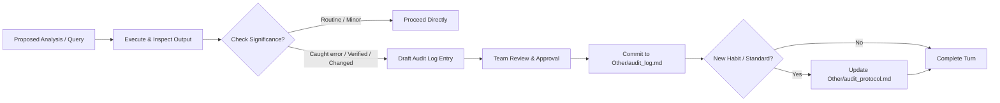

# 🛡️ Data Audit Protocol

<p align="center">
  
  
  
  
</p>

---

## 🎯 1. Purpose & Objectives

This **Audit Protocol** defines the quality assurance framework, data verification standards, and AI collaboration rules for **Team Optimus Pride (Team 6)** in **BUSM 410 (Big Data and Advanced Analytics)** at Brigham Young University–Hawaii.

Our objective is to ensure that all data transformations, statistical benchmarks, and business opportunity estimates derived from the **Chicago Taxi Trips** dataset (`bigquery-public-data.chicago_taxi_trips.taxi_trips`) are:
1. **Accurate & Verifiable:** Grounded in documented queries and reproducible data pipelines.
2. **Defensible & Fair:** Comparing like with like (the same months in each year).
3. **Transparent:** Clearly separating empirical observations from modeling assumptions and management interpretations.

---

## 👥 2. Roles & Governance

| Role | Name / Entity | Responsibilities |
|---|---|---|
| **Student Analyst** | Helaman Gonzaga | Query design, metric selection, data verification, final approval. |
| **Student Analyst** | Nerlyn Dave Alcantara | Data pipeline audit, benchmark validation, documentation review. |
| **AI Co-Pilot** | Antigravity (Google DeepMind) | Query drafting, automated consistency checks, protocol tracking, log staging. |
| **AI Assistant** | Claude (Anthropic) | Drafted the CP1 queries, chart, and write-ups on November 10, 2026. The team ran every query in BigQuery and approved the results. |

### Collaboration Rules of Engagement
* **Pre-commit Review:** The AI assistant must propose any addition to `audit_protocol.md` or `audit_log.md` and obtain team approval before saving.
* **Substantial Logging Only:** Routine approvals, minor syntax corrections, and trivial edits are skipped. Only checks that caught a mistake, validated a key assumption against external ground truth, or altered our analytical strategy are logged.
* **Preservation of Truth:** Never invent or backfill a check that was not genuinely performed.

---

## 🔬 3. Data Auditing Standards & Checklist

### How we direct and check our agent

1. **One step at a time.** The agent drafts one short query. We run it ourselves in BigQuery and send back the result before the next step.
2. **We run it, the agent reads it.** The agent never reports a number we have not seen in our own BigQuery results.
3. **Check before trusting.** When a number looks surprising (too big, too small, or too neat), we ask for a check query before we use it.
4. **Approve before saving.** The agent shows us each file or log entry first. Nothing is saved until we say so.
5. **Match the numbers.** Before we submit, the numbers in `findings.md`, `README.md`, and `sql/README.md` must be the same.

### Checks for our current gap (trip decline, Jan–May 2017 to 2019)

Every query result must pass these before it goes into `findings.md`:

* [x] **Count rows by month before comparing years.** A low year may just be missing months. (Audit log check 10)
* [x] **Compare the same months in every year.** We use January to May only.
* [x] **Check for duplicates.** Compare `COUNT(*)` with `COUNT(DISTINCT unique_key)`. Count each trip once. (Check 11)
* [x] **Check that duplicates are exact copies** before removing them. (Check 13)
* [x] **Check for blank, impossible, and future values** in every column the gap uses. (Check 14)
* [x] **Check a price against an outside source.** (Check 15)
* [x] **Say what is measured and what is estimated.** Measured numbers come from a query. Estimates are labeled as estimates. (Check 16)
* [x] **Do not state a cause we have not tested.** We do not know why trips fell.

### Retired: checks for our first approach (fare per taxi, 2022–2023)

We used these gates before November 10, 2026. We changed our gap (audit log check 17), so they no longer apply. They stay here as a record.

### Gate A: Temporal & Coverage Integrity
* [x] **Date Window Verification:** Always run `MIN(trip_start_timestamp)` and `MAX(trip_start_timestamp)` to confirm boundary dates.
* [x] **Missing Period Check:** Verify record count distributions across months to detect truncated intervals (e.g., verifying why Jan–Jun 2021 is incomplete in the public source table and shifting scope to complete calendar years 2022–2023).
* [ ] **Reconciliation Check:** Compare aggregated segment fares against an unconditional `SUM(fare)` across the raw filtered table to ensure zero loss or double-counting.

### Gate B: Granularity & Metric Definitions
* [x] **Entity Identification:** Group by `pickup_community_area` and `EXTRACT(HOUR FROM trip_start_timestamp)`.
* [x] **Fleet Utilization Metric:** Utilize `COUNT(DISTINCT taxi_id)` to establish active vehicle counts per area-hour slot.
* [x] **Standard Performance KPI:** Measure **Fare per Taxi** ($\frac{\text{Total Fare}}{\text{Active Taxis}}$) rather than simple total fare, isolating vehicle productivity from fleet size.

### Gate C: Outlier & Structural Segmentation
* [x] **Airport Surge Isolation:** Isolate high-volume airport hubs from standard neighborhood benchmarks:
  * **Community Area 76:** O'Hare International Airport (verified against City of Chicago GIS data).
  * **Community Area 56:** Garfield Ridge / Midway International Airport (verified against City of Chicago GIS data).
* [x] **Minimum Sample Threshold:** Exclude low-sample area-hour slots ($<1{,}000$ trips over the 2-year window) to prevent volatile single-trip distortions.

### Gate D: Benchmarking Rigor & Sensitivity
* [x] **Temporal Control:** Benchmark community areas strictly against peers **within the exact same hour of the day** to prevent night lulls (e.g., 4:00 AM) from being penalized against midday peaks.
* [x] **Primary Benchmark:** Calculate the **75th percentile** of fare-per-taxi within each hour slot as the high-performance standard.
* [ ] **Sensitivity Benchmark:** Re-run calculations at the **50th percentile (median)** to establish an empirical conservative-to-optimistic opportunity gap range.

### Gate E: Metric Framing & Language Precision
* [x] **"Up To" Framing:** Because opportunity gaps are mathematical potentials contingent on fleet repositioning and market elasticities, always communicate gaps as **"up to \$X"** rather than guaranteed bottom-line revenues.
* [x] **Separation of Fact vs. Opinion:** Explicitly tag empirical numbers as facts and optimization targets as modeled projections.

---

## 📝 4. Audit Log Schema & Taxonomy

All formal checks must be recorded in [`Other/audit_log.md`](audit_log.md) using the uniform table schema:

```markdown
| # | What I checked | How | What I found | What I did about it |
```

Each logged entry must be filed under one of the **5 standard categories**:
1. **`Caught an error`**: Pipeline defects, data truncations, null traps, or misleading numbers.
2. **`Verified a claim`**: Validating distributions, row counts, external IDs, or geographic boundaries.
3. **`Separated fact from opinion`**: Isolating raw empirical values from benchmark assumptions or business claims.
4. **`Changed the analysis`**: Refining KPI definitions, updating filters, or expanding modeling dimensions.
5. **`Improved the agent's instructions`**: Establishing repeatable standards, prompt constraints, and verification habits.

---

## 🔄 5. Habit Retention & Maintenance Workflow



*This protocol is a living document maintained by Team Optimus Pride and updated as new methodological habits are established.*
