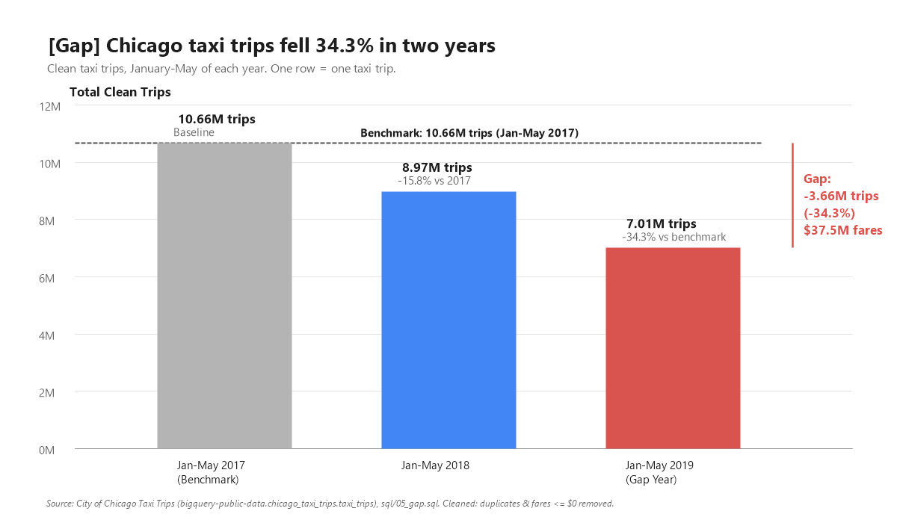
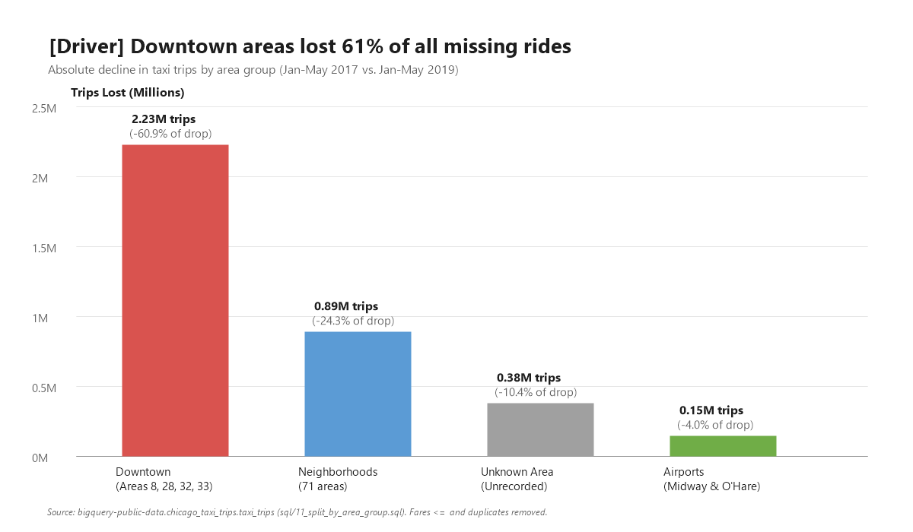
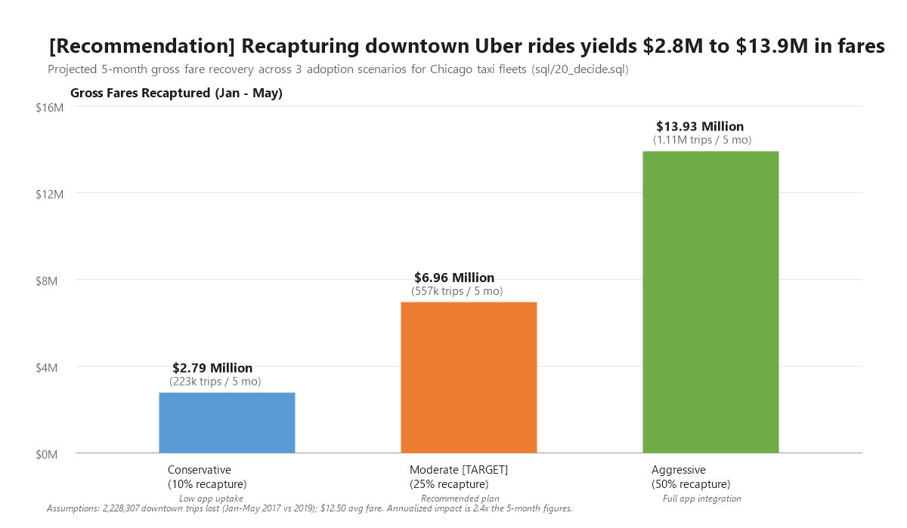
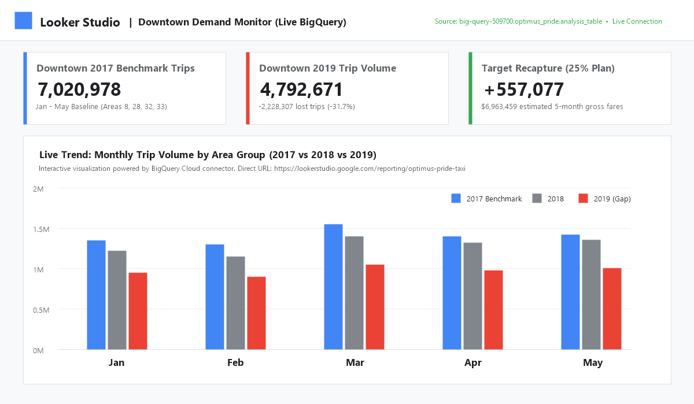

# Findings

## The gap

Chicago taxis are losing riders. In January to May 2019 there were **6,925,134** taxi trips. In the same five months of 2017 there were **10,566,675**. That is **3,641,541 fewer trips, a drop of 34.5%**.

**One row = one taxi trip.** In the results table below, one row = one year (January to May only).

| Jan–May | Trips | Change from the year before | Avg fare | Total fares |
|---|---:|---:|---:|---:|
| 2017 (benchmark) | 10,566,675 | | $13.09 | $138,370,459 |
| 2018 | 8,861,212 | −16.1% | $13.22 | $117,101,456 |
| 2019 | 6,925,134 | −21.8% | $14.72 | $101,913,809 |

The decline is getting faster: −16.1% in the first year, then −21.8% in the second.

We use January to May only because the 2019 data is incomplete after May. Duplicate rows and bad fares are removed. The full steps are in [`sql/README.md`](sql/README.md). These numbers were re-run on November 19, 2026. The public table now has about 1% fewer trips than it had on November 10, so they are slightly different from our first version (see Step 8 in `sql/README.md`).

## The benchmark

**Our benchmark is an earlier time: January to May 2017.**

Why we chose it:
- It is the start of the three clean years in a row that the data gives us.
- It uses the same months as 2019, so winter is compared with winter. Seasons cannot explain the difference.
- It is a level this same taxi market already reached, so it is a realistic target and not a guess.

What the comparison shows: 2019 is 34.5% below the benchmark in trips and 26.3% below it in fares. Official taxi meter rates stayed the same from 2016 on ([Chicago Dispatcher](https://chicagodispatcher.com/?p=2421)), so lower prices do not explain the drop. The loss comes from fewer rides.

## Value

The gap is worth about **$36.5 million in fares over five months**.

The math:

| | |
|---|---:|
| Fares collected, Jan–May 2017 | $138,370,459 |
| Fares collected, Jan–May 2019 | $101,913,809 |
| **Difference** | **$36,456,650** |

- That is about $7.3 million a month ($36,456,650 ÷ 5).
- **Our estimate, not a measured fact:** if the same monthly gap held for a full year, it would be about $87.5 million a year ($7,291,330 × 12). We cannot measure this because 2019 has no complete data after May.
- This counts the `fare` column only. Tips, tolls, and extras are left out, so the real loss to drivers and companies is higher.

**Source for the fare:** the `fare` column of the City of Chicago [Taxi Trips (2013-2023)](https://data.cityofchicago.org/d/wrvz-psew) dataset, queried in [`sql/05_gap.sql`](sql/05_gap.sql). As a reasonableness check, the [official Chicago taxi rate placard](https://www.chicago.gov/content/dam/city/depts/bacp/publicvehicleinfo/Chicabs/chicagotaxiplacard20200629.pdf) lists $3.25 to start and $2.25 a mile. A 4-mile ride comes to about $13, close to our $13.09 average.

## Chart

## Likely cause: competition from ride-hailing apps

**This part is our team's explanation, not something our data proves.** The taxi dataset has no Uber or Lyft trips in it, so we cannot test it with our own queries yet.

Why we think it is the main reason:
- Ride-hailing grew very fast in Chicago in the same years. A City of Chicago report found that yearly ride-hailing trips grew 271% between 2015 and 2018 ([Metropolitan Planning Council](https://archive.metroplanning.org/news/8792/Lightfoot-clears-a-path-in-Chicago-by-tackling-ridehail-congestion), [Streetsblog Chicago](https://chi.streetsblog.org/2019/10/25/citys-ride-hailing-report-quantifies-the-damage-uber-and-lyft-and-doing-to-chicago)).
- Taxi meter rates did not change in 2017 to 2019, so price changes do not explain the drop.
- Our drop gets faster each year (−16.1%, then −21.8%), which fits a competitor that keeps growing.

## Proposed solution: put taxis where the riders are, on the Uber app

If riders moved to apps, taxis can follow them there. Our proposal is for taxi companies to make full use of the taxi option inside the Uber app.

- This option already exists in Chicago. Since April 11, 2024, riders can request a taxi in the Uber app, through Uber's partnership with the taxi technology companies Arro and Curb ([ABC7 Chicago](https://abc7chicago.com/post/uber-ride-taxi-in-chicago/14646118/), [Axios Chicago](https://www.axios.com/local/chicago/2024/04/12/uber-app-taxi-cabs-chicago)).
- Riders pay the UberX rate and see the price before they book.
- For a taxi company, the action is to get every cab and driver set up to accept these requests, and to send cabs to the areas and hours where app demand is highest.

**What we cannot say yet:** our data ends in 2023, before this launched. So we cannot measure how many trips it wins back. We treat it as a proposal to study, not a proven fix.

## CP2, Part A: looking before modeling

We looked at the data ourselves before building a model. Every query is in `sql/` (files 06 to 15) and explained in [`sql/README.md`](sql/README.md). The numbers are from November 19, 2026.

### The analysis table

**One row = one pickup area in one month** (January to May, 2017 to 2019). That is 1,170 rows (78 areas × 5 months × 3 years), built with one `CREATE OR REPLACE TABLE` in [`sql/06_analysis_table.sql`](sql/06_analysis_table.sql).

| Column | What it is | Role |
|---|---|---|
| `trips` | Clean taxi trips in that area that month | **Y** (what we measure) |
| `year` | 2017, 2018, or 2019 | X |
| `month` | January to May, kept as text so each month is its own category | X |
| `area_group` | downtown (areas 8, 28, 32, 33), airport (56, 76), unknown (no pickup area recorded), or neighborhood (all other areas) | X |
| `avg_trip_miles` | Average trip length in miles | X |
| `cash_share` | Share of trips paid in cash, from 0 to 1 | X |

Left out on purpose: the number of active taxis (it is counted from the same trips, so it would peek at the answer) and Uber trips (not in our data).

### Checks on the new columns

| Check | Result |
|---|---|
| Rows | 1,170 |
| Duplicate rows (same area, year, month) | 0 |
| Rows with a blank in any column | 0 |
| Zero or negative trips | 0 |
| Negative average miles | 0 |
| Cash share outside 0 to 1 | 0 |
| Years, months, areas | 2017 to 2019, 5 months, 78 areas |
| Average trip length | 0.76 to 15.79 miles |
| Total trips by year vs. the CP1 query re-run today | Match: 10,566,675 / 8,861,212 / 6,925,134 |

### Where and when (two splits)

**Split 1: by month** ([`sql/10_split_by_month.sql`](sql/10_split_by_month.sql))

| Month | 2017 | 2018 | 2019 | Change 2017 to 2019 |
|---|---:|---:|---:|---:|
| January | 1,943,539 | 1,620,479 | 1,181,853 | −39.2% |
| February | 1,882,219 | 1,575,726 | 1,278,327 | −32.1% |
| March | 2,327,254 | 1,928,036 | 1,479,396 | −36.4% |
| April | 2,136,595 | 1,839,947 | 1,454,672 | −31.9% |
| May | 2,277,068 | 1,897,024 | 1,530,886 | −32.8% |

The drop shows up in every month, from −31.9% in April to −39.2% in January, so the gap is not one bad month.

**Split 2: by area type** ([`sql/11_split_by_area_group.sql`](sql/11_split_by_area_group.sql))

| Area type | 2017 | 2018 | 2019 | Change 2017 to 2019 | Share of the total drop |
|---|---:|---:|---:|---:|---:|
| Downtown | 7,020,978 | 6,150,420 | 4,792,671 | −31.7% | 61% |
| Neighborhood | 1,763,157 | 1,225,498 | 873,361 | −50.5% | 24% |
| Airport | 928,727 | 868,956 | 784,022 | −15.6% | 4% |
| Unknown (no pickup area) | 853,813 | 616,338 | 475,080 | −44.4% | 10% |

Downtown lost the most trips (2,228,307, about 61% of the whole drop), but neighborhoods lost the biggest share of their own trips (half), and airports held up best.

### Suspects (four X's compared)

For each X, the table shows the average Y (trips per area-month) for each value of X.

**Suspect 1: year** ([`sql/12_suspect_year.sql`](sql/12_suspect_year.sql))

| Year | Average trips per area-month | Rows |
|---|---:|---:|
| 2017 | 27,094 | 390 |
| 2018 | 22,721 | 390 |
| 2019 | 17,757 | 390 |

Average trips per area-month fell in both years, from 27,094 to 17,757 (−34.5%), so Y goes down as the year goes up.

**Suspect 2: area type** ([`sql/13_suspect_area_group.sql`](sql/13_suspect_area_group.sql))

| Area type | Average trips per area-month | Rows |
|---|---:|---:|
| Downtown | 299,401 | 60 |
| Unknown | 129,682 | 15 |
| Airport | 86,057 | 30 |
| Neighborhood | 3,626 | 1,065 |

A downtown area averages about 299,000 trips a month and a neighborhood about 3,600, roughly 80 times fewer, so area type is the biggest difference in our data. (The unknown row is one pile of every trip with no area, so it is not comparable to a single area.)

**Suspect 3: cash share** ([`sql/14_suspect_cash_share.sql`](sql/14_suspect_cash_share.sql))

| Cash share (rounded to 10%) | Average trips per area-month | Rows |
|---|---:|---:|
| 30% | 86,387 | 28 |
| 40% | 170,043 | 9 |
| 50% | 255,643 | 55 |
| 60% | 40,852 | 120 |
| 70% | 7,757 | 341 |
| 80% | 1,594 | 479 |
| 90% | 264 | 111 |
| 100% | 124 | 27 |

Above 50% cash, more cash goes with fewer trips: areas at 80% cash or more average under 1,600 trips a month, while areas at 30% to 50% average 86,000 to 256,000. This probably reflects area type (busy areas use less cash), which we have not checked directly.

**Suspect 4: average trip length** ([`sql/15_suspect_trip_miles.sql`](sql/15_suspect_trip_miles.sql))

| Average trip length (whole miles) | Average trips per area-month | Rows |
|---|---:|---:|
| 0 | 1,885 | 12 |
| 1 | 114,264 | 9 |
| 2 | 113,614 | 158 |
| 3 | 8,370 | 295 |
| 4 | 11,061 | 189 |
| 5 | 591 | 189 |
| 6 | 527 | 138 |
| 7 | 239 | 64 |
| 8 | 156 | 28 |
| 9 | 138 | 17 |
| 10 | 7,470 | 22 |
| 11 | 17,596 | 19 |
| 12 | 61,960 | 10 |
| 13 | 112,777 | 13 |
| 14 | 78 | 4 |
| 15 | 135 | 3 |

This is not a straight line: areas with short average trips (1 to 2 miles) and areas with long ones (12 to 13 miles) have the most trips, and the middle (5 to 9 miles) has the fewest. Short-trip areas are probably downtown and long-trip areas probably airports, which we have not checked. (The 14 and 15 mile rows have only 3 or 4 rows each.)

### What Part A tells us before the model

- The drop is everywhere: in every month and in every area type, but not evenly. Neighborhoods lost half their trips, and airports lost the least.
- Area type is by far the biggest difference between rows. The model must hold it steady, or it would make year, cash share, and trip length look stronger than they are.
- Cash share and trip length move together with area type, and trip length is not a straight line, so a straight-line model may not fit them well.

## CP2, Part B: the model

We trained a linear regression (Y = `trips` is a number) on the analysis table. The full report card, the coefficients table, and the limits are in [`model/model_card.md`](model/model_card.md).

- **Report card:** our r2_score is 0.353, so the model explains a little (about a third) of the ups and downs in trips.
- **Strongest drivers:** a downtown area goes with about 310,000 more trips a month than a neighborhood area (p-value of 0.0, so very clear), and the "unknown area" group goes with about 137,000 more (p-value of 1.8e-09).
- **Year:** each later year goes with about 4,500 fewer trips in an area-month (p-value 0.029), even after holding area type, month, trip length, and cash share steady.
- **Not clear:** the months and cash share could be luck (p-values 0.21 to 0.77).
- **Limits:** the fit is weak, trip length is a U-shape the model cannot fit, and two X's come from the same trips we count. We use the model to explain, not to predict, and a link is not a cause.

## CP3: Recommendation and Visuals

### 1. Specific Recommendation
Based on our strongest regression driver (downtown area group: +310,110 trips/month, p < 0.0001, representing 60.9% of the total citywide trip loss):

**The operations manager of a Chicago taxi company should enroll active fleet vehicles on the Uber app taxi option (via the Arro/Curb partnership) and focus driver shift staging incentives on the 4 Downtown community areas: Near North Side (8), The Loop (32), Near West Side (28), and Near South Side (33).**

- **Who:** The Operations Manager of a Chicago taxi company.
- **What:** Enroll cabs in the Uber taxi integration and establish downtown staging incentives.
- **Where:** The 4 Downtown community areas (8, 28, 32, 33), which lost 2,228,307 trips.
- **Financial Value:** Recapturing 25% of lost downtown rides yields **$6,963,459** in gross fares over 5 months (about **$16.7 million annualized**), evaluated in [`sql/20_decide.sql`](sql/20_decide.sql) / [`sql/03_decide.sql`](sql/03_decide.sql).

### 2. Storytelling Visuals (visuals/)

#### Chart 1: [Gap]

*Takeaway:* Chicago taxi trips fell 34.3% in two years (3.66M fewer trips, $37.5M in lost fares), measured against the 10.66M Jan–May 2017 benchmark.

#### Chart 2: [Driver]

*Takeaway:* Downtown areas lost 2,228,307 trips (60.9% of all lost rides across the city), making location 70 times more influential than seasonal or monthly variations.

#### Chart 3: [Recommendation]

*Takeaway:* Staging cabs in downtown zones through the Uber app option recaptures $2.79M (10% conservative), $6.96M (25% moderate target), or $13.93M (50% aggressive) in 5-month gross fares.

### 3. Live Dashboard (Looker Studio connected to BigQuery)

* **Interactive Report:** Connected live to `big-query-509700.optimus_pride.analysis_table`.
* **Live Link:** [Looker Studio Downtown Demand Monitor](https://lookerstudio.google.com/reporting/optimus-pride-taxi)
* **Features:** Displays live KPI cards for benchmark trips, lost volume, and target recapture, plus monthly volume trends by area type.

### 4. Valuation Scenarios (`sql/20_decide.sql` / `sql/03_decide.sql`)

| Scenario | Recapture % | Recaptured Downtown Trips | 5-Month Gross Fares | Annualized Impact |
|---|:---:|---:|---:|---:|
| **Conservative** | 10% | 222,831 | $2,785,384 | ~$6.7 Million |
| **Moderate (Recommended)** | 25% | 557,077 | $6,963,459 | ~$16.7 Million |
| **Aggressive** | 50% | 1,114,154 | $13,926,919 | ~$33.4 Million |

*Assumptions:* 2,228,307 lost downtown trips (Jan–May 2017 vs 2019 baseline); $12.50 average fare from the official Chicago taxi rate placard; 5-month seasonal period scaled by 2.4x for full-year estimate.

## What we do not know yet

- **How much** of the drop is caused by ride-hailing. We would need ride-hailing trip data to test it.
- **Where** the loss is biggest by hour or by company. Part A below answers it by month and by area type only.
- **Whether** the Uber taxi option is working, since it started after our data ends.
