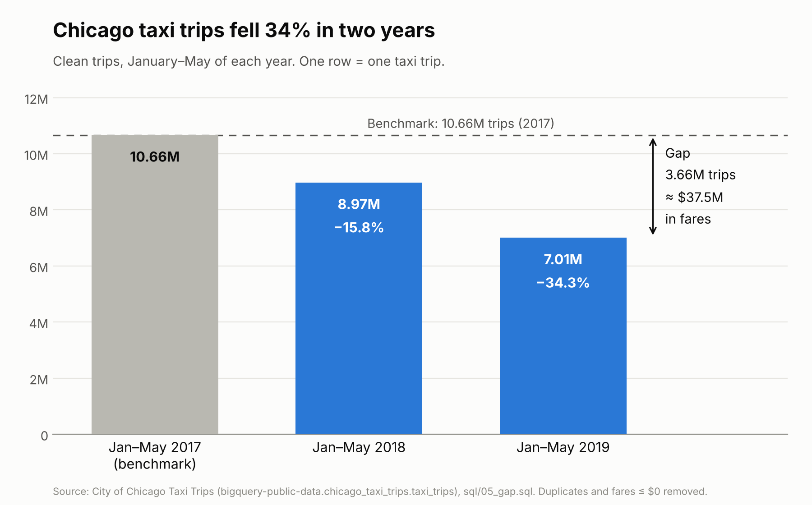

# Findings

## The gap

Chicago taxis are losing riders. In January to May 2019 there were **7,007,630** taxi trips. In the same five months of 2017 there were **10,664,759**. That is **3,657,129 fewer trips, a drop of 34.3%**.

**One row = one taxi trip.** In the results table below, one row = one year (January to May only).

| Jan–May | Trips | Change from the year before | Avg fare | Total fares |
|---|---:|---:|---:|---:|
| 2017 (benchmark) | 10,664,759 | | $13.20 | $140,811,879 |
| 2018 | 8,974,977 | −15.8% | $13.27 | $119,102,382 |
| 2019 | 7,007,630 | −21.9% | $14.74 | $103,295,724 |

The decline is getting faster: −15.8% in the first year, then −21.9% in the second.

We use January to May only because the 2019 data is incomplete after May. Duplicate rows and bad fares are removed. The full steps are in [`sql/README.md`](sql/README.md).

## The benchmark

**Our benchmark is an earlier time: January to May 2017.**

Why we chose it:
- It is the start of the three clean years in a row that the data gives us.
- It uses the same months as 2019, so winter is compared with winter. Seasons cannot explain the difference.
- It is a level this same taxi market already reached, so it is a realistic target and not a guess.

What the comparison shows: 2019 is 34.3% below the benchmark in trips and 26.6% below it in fares. Official taxi meter rates stayed the same from 2016 on ([Chicago Dispatcher](https://chicagodispatcher.com/?p=2421)), so lower prices do not explain the drop. The loss comes from fewer rides.

## Value

The gap is worth about **$37.5 million in fares over five months**.

The math:

| | |
|---|---:|
| Fares collected, Jan–May 2017 | $140,811,879 |
| Fares collected, Jan–May 2019 | $103,295,724 |
| **Difference** | **$37,516,155** |

- That is about $7.5 million a month ($37,516,155 ÷ 5).
- **Our estimate, not a measured fact:** if the same monthly gap held for a full year, it would be about $90 million a year ($7,503,231 × 12). We cannot measure this because 2019 has no complete data after May.
- This counts the `fare` column only. Tips, tolls, and extras are left out, so the real loss to drivers and companies is higher.

**Source for the fare:** the `fare` column of the City of Chicago [Taxi Trips (2013-2023)](https://data.cityofchicago.org/d/wrvz-psew) dataset, queried in [`sql/05_gap.sql`](sql/05_gap.sql). As a reasonableness check, the [official Chicago taxi rate placard](https://www.chicago.gov/content/dam/city/depts/bacp/publicvehicleinfo/Chicabs/chicagotaxiplacard20200629.pdf) lists $3.25 to start and $2.25 a mile. A 4-mile ride comes to about $13, close to our $13.20 average.

## Chart

## Likely cause: competition from ride-hailing apps

**This part is our team's explanation, not something our data proves.** The taxi dataset has no Uber or Lyft trips in it, so we cannot test it with our own queries yet.

Why we think it is the main reason:
- Ride-hailing grew very fast in Chicago in the same years. A City of Chicago report found that yearly ride-hailing trips grew 271% between 2015 and 2018 ([Metropolitan Planning Council](https://archive.metroplanning.org/news/8792/Lightfoot-clears-a-path-in-Chicago-by-tackling-ridehail-congestion), [Streetsblog Chicago](https://chi.streetsblog.org/2019/10/25/citys-ride-hailing-report-quantifies-the-damage-uber-and-lyft-and-doing-to-chicago)).
- Taxi meter rates did not change in 2017 to 2019, so price changes do not explain the drop.
- Our drop gets faster each year (−15.8%, then −21.9%), which fits a competitor that keeps growing.

## Proposed solution: put taxis where the riders are, on the Uber app

If riders moved to apps, taxis can follow them there. Our proposal is for taxi companies to make full use of the taxi option inside the Uber app.

- This option already exists in Chicago. Since April 11, 2024, riders can request a taxi in the Uber app, through Uber's partnership with the taxi technology companies Arro and Curb ([ABC7 Chicago](https://abc7chicago.com/post/uber-ride-taxi-in-chicago/14646118/), [Axios Chicago](https://www.axios.com/local/chicago/2024/04/12/uber-app-taxi-cabs-chicago)).
- Riders pay the UberX rate and see the price before they book.
- For a taxi company, the action is to get every cab and driver set up to accept these requests, and to send cabs to the areas and hours where app demand is highest.

**What we cannot say yet:** our data ends in 2023, before this launched. So we cannot measure how many trips it wins back. We treat it as a proposal to study, not a proven fix.

## What we do not know yet

- **How much** of the drop is caused by ride-hailing. We would need ride-hailing trip data to test it.
- **Where** the loss is biggest (which areas, hours, or companies). That is the next step of the project.
- **Whether** the Uber taxi option is working, since it started after our data ends.
